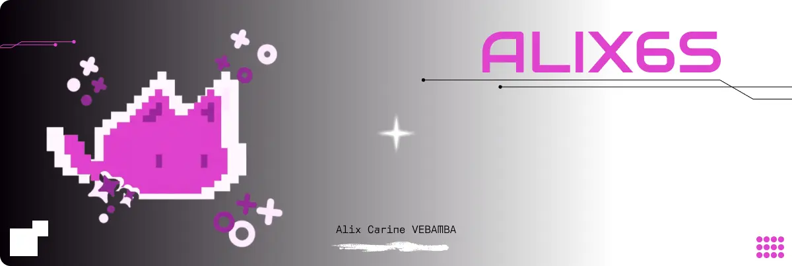

  

 
 

  <svg xmlns="http://www.w3.org/2000/svg" width="20" height="20" viewBox="0 0 24 24" fill="#d60cfe" style="vertical-align: middle;">
    <path d="M12 2l1.5 8.5L22 12l-8.5 1.5L12 22l-1.5-8.5L2 12l8.5-1.5z"/>
  </svg>
  <strong style="font-size: 1.5em; vertical-align: middle;"> About Me </strong>
  <svg xmlns="http://www.w3.org/2000/svg" width="20" height="20" viewBox="0 0 24 24" fill="#d60cfe" style="vertical-align: middle;">
    <path d="M12 2l1.5 8.5L22 12l-8.5 1.5L12 22l-1.5-8.5L2 12l8.5-1.5z"/>
  </svg>

 

<table width="100%">
<tr>
<td valign="top" style="text-align: justify;">
  
    
  Passionate about Artificial Intelligence, Data Science, and software development. I enjoy solving complex problems, learning new technologies, and building practical solutions that make a positive impact. My experience spans machine learning, data analysis, mobile application development, and research. I particularly enjoy working at the intersection of AI and healthcare, where technology can improve people's lives. Beyond technical skills, I value curiosity, continuous learning, teamwork, and innovation. I aspire to become an AI and Data Science professional who develops intelligent systems capable of solving real-world problems, especially in contexts where technology can create meaningful opportunities and improve access to essential services.
</td>
<td width="35%" valign="top" align="center">
  
</td>
</tr>
</table>

 
 

  <svg xmlns="http://www.w3.org/2000/svg" width="20" height="20" viewBox="0 0 24 24" fill="#d60cfe" style="vertical-align: middle;">
    <path d="M12 2l1.5 8.5L22 12l-8.5 1.5L12 22l-1.5-8.5L2 12l8.5-1.5z"/>
  </svg>
  <strong style="font-size: 1.5em; vertical-align: middle;"> Stack & Stats </strong>
  <svg xmlns="http://www.w3.org/2000/svg" width="20" height="20" viewBox="0 0 24 24" fill="#d60cfe" style="vertical-align: middle;">
    <path d="M12 2l1.5 8.5L22 12l-8.5 1.5L12 22l-1.5-8.5L2 12l8.5-1.5z"/>
  </svg>

 

<table width="100%">
<tr>
<td width="50%" valign="top">

**Core Stack**

**Also Comfortable With**

</td>
<td width="50%" valign="top" align="center">

</td>
</tr>
</table>

 
 

<table width="100%">
<tr>
<td width="50%" valign="top" align="center">

</td>
<td width="50%" valign="top" align="center">

</td>
</tr>
</table>

 
 

  

